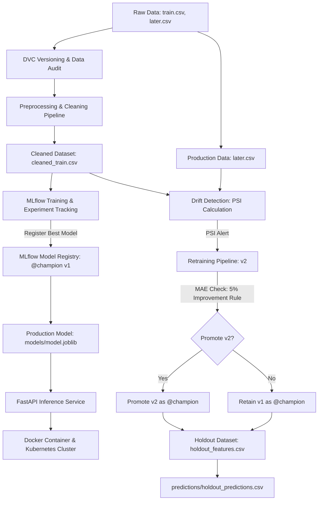

# G057 – Wheat Yield MLOps

## Project Information

- **Course:** SCSE3040 – MLOps
- **Group ID:** G057
- **Problem ID:** MP161
- **Problem:** Wheat Yield per Acre (Jaipur)
- **Faculty:** Dr. Avantika Saklani
- **Batch:** 75

## Group Members

| Enrolment Number | Name |
|---|---|
| S24CSEU2751 | Ashmit Baliyan |
| S24CSEU2755 | Udit Taneja |
| S24CSEU2726 | Aryan Kumar |
| S24CSEU2753 | Ashmit Bhatnagar |

---

## 1. Project Overview & Client Context

**Client:** Jaipur Kisan Producer Company  
A farmer producer company near Jaipur buys wheat from its members. Before harvest, it must book logistics trucks and mandi storage. By accurately estimating wheat yield per acre (`yield_qtl_per_acre` in quintals per acre) from seasonal agronomic features, the organization optimizes truck bookings, prevents post-harvest storage losses, and alerts farmers early when crops face sub-optimal yield risks.

This repository implements the complete end-to-end production MLOps pipeline covering:
1. **Stage 1 – Data Auditing & DVC Versioning:** Systematic detection of 7 data anomalies and data version control.
2. **Stage 2 – Data Preprocessing & Baseline MLflow Experiments:** Data cleaning, hyperparameter exploration, SQLite experiment tracking, and model registration.
3. **Stage 3 – Production Serving, Testing & Containerization:** Production FastAPI service with client rule enforcement, structured JSON logging, pytest suite, Docker containerization, and GitHub Actions CI.
4. **Stage 4 – Kubernetes, Monitoring, Retraining & Holdout Inference:** Kubernetes deployment manifests, PSI-based data drift detection, automated retraining with 5% MAE improvement promotion threshold, champion model updates, and final holdout predictions.

---

## 2. End-to-End MLOps Architecture



---

## 3. Repository Structure

```
├── .dvc/                            # DVC configuration
├── .github/
│   └── workflows/
│       └── ci.yml                   # GitHub Actions CI workflow (lint, test, build)
├── app/
│   ├── __init__.py
│   └── main.py                      # Production FastAPI inference application
├── data/
│   ├── raw/                         # Raw CSV datasets (tracked via DVC)
│   │   ├── train.csv.dvc
│   │   ├── later.csv.dvc
│   │   └── holdout_features.csv.dvc
│   ├── processed/
│   │   └── cleaned_train.csv.dvc
│   ├── .gitignore
│   └── raw.dvc
├── k8s/
│   ├── deployment.yaml              # Kubernetes Deployment (mp161-api, 2 replicas)
│   ├── service.yaml                 # Kubernetes Service (mp161-svc, port 80 -> 8000)
│   ├── configmap.yaml               # Kubernetes ConfigMap for runtime environment
│   └── secret.yaml                  # Kubernetes Secret for sensitive credentials
├── models/
│   └── model.joblib                 # Champion model loaded by FastAPI service
├── predictions/
│   └── holdout_predictions.csv      # Scored holdout predictions (record_id, prediction)
├── reports/
│   ├── data_audit.txt               # Stage 1 data audit findings report
│   ├── drift_report.json            # Stage 4 feature-level PSI drift report
│   ├── findings.yaml                # Standardized project evaluation submission form
│   └── top_10_high_yield.csv        # Top 10 yield records audit
├── src/
│   ├── __init__.py
│   └── wheat_yield/
│       ├── __init__.py
│       ├── data_audit.py            # Stage 1 anomaly detection script
│       ├── drift_detection.py       # Stage 4 PSI calculation and drift alerting
│       ├── generate_data.py         # Synthetic raw data generator
│       ├── logger.py                # Structured JSON logging utility
│       ├── model_training.py        # Stage 2/3 MLflow tracking & model registration
│       ├── predict_holdout.py       # Stage 4 holdout prediction scoring
│       ├── preprocessing.py         # Stage 2 data cleaning & feature alignment
│       └── retrain.py               # Stage 4 drift retraining & promotion logic
├── tests/
│   ├── __init__.py
│   ├── test_api.py                  # FastAPI TestClient endpoint and rule tests
│   ├── test_drift.py                # PSI calculation and drift threshold tests
│   ├── test_features.py             # Feature definition and transformer tests
│   ├── test_model.py                # Model artifact loading and inference tests
│   ├── test_preprocessing.py        # Data cleaning and anomaly correction tests
│   └── test_utils.py                # Logger, config, and utility tests
├── .dockerignore                    # Build ignore file for Docker
├── .dvcignore                       # DVC ignore specifications
├── .gitignore                       # Git ignore specifications
├── docker-compose.yml               # Local multi-container Docker compose
├── Dockerfile                       # Multi-stage production container definition
├── findings.yaml                    # Root findings submission form
├── GROUP.md                         # Group allocation metadata
├── mlflow.db                        # SQLite MLflow tracking & registry database
├── params.yaml                      # Project hyperparameter and tracking configuration
├── PROBLEM.md                       # Client problem brief and specifications
├── README.md                        # Project documentation
├── requirements.txt                 # Pinned dependencies
└── STUDENT_HANDBOOK.md              # Course and submission guidelines
```

---

## 4. Installation & Environment Setup

### Prerequisites
- Python 3.12+
- Git

### Local Environment Setup
```bash
# Clone the repository
git clone <repository-url>
cd G057-Wheat-Yield-MLOps-master

# Create and activate virtual environment
python -m venv .venv

# On Linux/macOS:
source .venv/bin/activate
# On Windows (PowerShell):
.venv\Scripts\Activate.ps1

# Install pinned dependencies
pip install --upgrade pip
pip install -r requirements.txt
```

---

## 5. End-to-End Workflow & Pipeline Execution

### Step 1: Preprocessing & Data Cleaning
Execute data cleaning to address sentinel values (999), Tehsil North unit mixup (10x), stuck sensor readings, target typos, and leakage columns:
```bash
python src/wheat_yield/preprocessing.py
```

### Step 2: MLflow Training & Experiment Tracking
Train 3 baseline model configurations (baseline, shallow, deeper), log metrics/parameters/artifacts to `sqlite:///mlflow.db`, and register version 1 as `@champion`:
```bash
python src/wheat_yield/model_training.py
```

### Step 3: Run the FastAPI Service
Launch the Uvicorn ASGI server hosting the REST API:
```bash
uvicorn app.main:app --host 0.0.0.0 --port 8000 --reload
```
Interactive documentation is available at `http://localhost:8000/docs`.

### Step 4: Drift Detection & Automated Retraining
Analyze distribution shifts between `cleaned_train.csv` and production `later.csv`, evaluate MAE by Tehsil group, retrain model v2, apply the 5% improvement promotion rule, and update `@champion`:
```bash
python src/wheat_yield/drift_detection.py
python src/wheat_yield/retrain.py
```

### Step 5: Score Holdout Dataset
Generate predictions on unseen holdout observations:
```bash
python src/wheat_yield/predict_holdout.py
```

---

## 6. MLflow Tracking & Model Registry

All runs are recorded to the local SQLite backend `sqlite:///mlflow.db` (MLflow 3 compliant):
- **Experiment:** `wheat-yield-prediction`
- **Logged Parameters:** `data_sha256`, `n_estimators`, `max_depth`, `min_samples_split`, `min_samples_leaf`, `random_state`
- **Logged Metrics:** `MAE`, `RMSE`, `R2`
- **Logged Artifacts:** Scikit-Learn Pipeline (`cloudpickle` serialization)
- **Model Registry:** Model `wheat-yield-champion` registered with alias `@champion`

### Starting the MLflow UI:
```bash
mlflow ui --backend-store-uri sqlite:///mlflow.db --port 5000
```
Open `http://localhost:5000` to view runs, compare parameters, and inspect registered models.

---

## 7. FastAPI Service Specification

The prediction service provides 3 REST endpoints:

### Endpoints
- **`GET /`**: Returns service metadata and API discovery information.
- **`GET /health`**: Returns `{"status": "ok", "model_loaded": true, "service": "wheat-yield-api"}` for Kubernetes readiness/liveness probes.
- **`POST /predict`**: Accepts JSON payload, validates constraints, and returns predicted wheat yield per acre.

### Client Validation Rules (Pydantic Schema)
1. **Rule 1 (`fertilizer_kg`):** Must not exceed `300.0` kg/acre (`Field(..., le=300)`). Rejects with **HTTP 422**.
2. **Rule 2 (`farm_acres`):** Must be non-negative (`Field(..., ge=0)`). Rejects with **HTTP 422**.
3. **Strict Fields:** Accepts only `rainfall_mm`, `fertilizer_kg`, `sowing_delay_days`, `irrigation_count`, `soil_ph`, `farm_acres`, `seed_variety`, `tehsil`.

### API Usage Examples

#### 1. Valid Prediction Request (cURL)
```bash
curl -X POST "http://localhost:8000/predict" \
     -H "Content-Type: application/json" \
     -d '{
       "rainfall_mm": 650.0,
       "fertilizer_kg": 110.0,
       "sowing_delay_days": 10.0,
       "irrigation_count": 4.0,
       "soil_ph": 6.8,
       "farm_acres": 5.5,
       "seed_variety": "HD-2967",
       "tehsil": "Tehsil South"
     }'
```
**Response (HTTP 200 OK):**
```json
{
  "predicted_yield_qtl_per_acre": 22.32,
  "unit": "quintals_per_acre",
  "model_version": "champion",
  "status": "success"
}
```

#### 2. Invalid Request (Violating Rule 1: fertilizer_kg > 300)
```bash
curl -X POST "http://localhost:8000/predict" \
     -H "Content-Type: application/json" \
     -d '{
       "rainfall_mm": 650.0,
       "fertilizer_kg": 350.0,
       "sowing_delay_days": 10.0,
       "irrigation_count": 4.0,
       "soil_ph": 6.8,
       "farm_acres": 5.5,
       "seed_variety": "HD-2967",
       "tehsil": "Tehsil South"
     }'
```
**Response (HTTP 422 Unprocessable Content):**
```json
{
  "detail": [
    {
      "type": "less_than_equal",
      "loc": ["body", "fertilizer_kg"],
      "msg": "Input should be less than or equal to 300",
      "input": 350.0,
      "ctx": {"le": 300.0}
    }
  ],
  "message": "Input validation failed. Please check field constraints."
}
```

---

## 8. Structured JSON Logging

All logs are formatted as single-line JSON streams to `stdout` following 12-factor cloud-native practices:
```json
{"timestamp": "2026-11-27T02:21:27.712161+00:00", "level": "INFO", "logger": "wheat_yield.api", "message": "Prediction computed: 22.32 qtl/acre in 14.46 ms", "event_type": "prediction_request", "tehsil": "Tehsil South", "seed_variety": "HD-2967", "farm_acres": 5.5, "predicted_yield_qtl_per_acre": 22.32, "latency_ms": 14.46}
```
- **Logged Events:** Startup, shutdown, model loading, request middleware latencies, prediction payloads (PII omitted), validation errors, and drift alerts.

---

## 9. Unit & Integration Testing

The test suite contains 25 test cases implemented with `pytest` and `fastapi.testclient.TestClient`. Tests do not rely on raw CSV files and generate isolated in-memory fixtures.

### Running Tests:
```bash
pytest -v
```

### Test Coverage Highlights:
- `test_preprocessing.py`: Duplicate dropping, Tehsil North unit mixup correction (10x), sentinel 999 imputation, stuck sensor imputation, target typo correction, and leakage column removal.
- `test_features.py`: Feature schema verification and unseen category handling (`handle_unknown="ignore"`).
- `test_model.py`: Model loading, persistence, and inference bounds checking.
- `test_api.py`: `GET /`, `GET /health`, valid `POST /predict`, Rule 1 validation, Rule 2 validation, missing field handling, and extra field rejection.
- `test_drift.py`: PSI calculation accuracy on identical and shifted distributions.
- `test_utils.py`: JSON logging formatter, config loading, and SHA-256 computation.

---

## 10. Containerization (Docker & Docker Compose)

The application is containerized using `python:3.12-slim` following security and caching best practices:
- Dependency layer caching (`requirements.txt` installed before copying application code)
- Non-root user execution (`appuser`)
- Docker healthcheck on `http://localhost:8000/health`
- Exact image tag: `mp161-api:1.0`

### Build and Run with Docker:
```bash
# Build the Docker image
docker build -t mp161-api:1.0 .

# Run the container
docker run -d -p 8000:8000 --name mp161-api mp161-api:1.0

# Check container health and logs
docker ps
docker logs -f mp161-api
```

### Run with Docker Compose:
```bash
docker-compose up -d
docker-compose logs -f
docker-compose down
```

---

## 11. Continuous Integration (GitHub Actions)

The CI workflow `.github/workflows/ci.yml` triggers on every `push` and `pull_request` to `master`/`main`:
1. Checks out repository.
2. Configures Python 3.12 environment with pip caching.
3. Installs dependencies.
4. Performs code linting with `flake8`.
5. Executes the complete pytest test suite (build fails if any test fails).
6. Builds Docker image `mp161-api:1.0` to verify container validity.

---

## 12. Kubernetes Deployment

Production Kubernetes manifests are located in `k8s/`:

| Manifest | Object | Specification |
|---|---|---|
| `k8s/deployment.yaml` | Deployment | Name: `mp161-api`, Replicas: `2`, Image: `mp161-api:1.0`, Container port: `8000` |
| `k8s/service.yaml` | Service | Name: `mp161-svc`, Port: `80` (forwarding to `8000`), Selector: `app: mp161-api` |
| `k8s/configmap.yaml` | ConfigMap | Name: `mp161-config`, Runtime configuration and log levels |
| `k8s/secret.yaml` | Secret | Name: `mp161-secret`, Secure credentials |

### Health Probes:
- **Readiness Probe:** `httpGet` on `/health` (initialDelay: 5s, period: 5s) to guarantee traffic only routes to initialized pods.
- **Liveness Probe:** `httpGet` on `/health` (initialDelay: 15s, period: 10s) with longer delay for graceful restarts.

### Deployment Commands:
```bash
# Apply Kubernetes configurations
kubectl apply -f k8s/configmap.yaml
kubectl apply -f k8s/secret.yaml
kubectl apply -f k8s/deployment.yaml
kubectl apply -f k8s/service.yaml

# Verify deployment status
kubectl get deployments
kubectl get pods -l app=mp161-api
kubectl get services mp161-svc
```

---

## 13. Drift Detection & Retraining Pipeline

### Drift Detection (PSI)
Population Stability Index (PSI) evaluates feature distribution stability between reference `cleaned_train.csv` and production `later.csv` over 10 quantile bins:
- `PSI < 0.1`: Negligible distribution shift
- `0.1 <= PSI < 0.2`: Moderate distribution shift
- `PSI >= 0.2`: Significant drift triggering alerts and retraining

**Observed PSI Metrics (`findings.yaml`):**
- `rainfall_mm`: 1.8835 (Drift)
- `fertilizer_kg`: 0.2998 (Drift)
- `sowing_delay_days`: 0.8334 (Drift)
- `irrigation_count`: 3.2701 (Highest Drift)
- `soil_ph`: 0.8329 (Drift)
- `farm_acres`: 0.1266 (Moderate Drift)
- **Most Drifted Feature:** `irrigation_count`

### Sub-District Fairness Audit
Model v1 MAE evaluated across sub-districts on `later.csv`:
- **Tehsil North:** 1.1743 (Worst-served group)
- **Tehsil South:** 1.0702
- **Tehsil West:** 1.1070

### Retraining & Client Promotion Decision
- Model v2 retrained on `cleaned_train.csv` plus the first 70% of sorted `later.csv`.
- Evaluated on remaining 30% check partition:
  - `mae_v1_on_check`: 1.1154
  - `mae_v2_on_check`: 0.9463
  - **Improvement:** 15.16% (exceeds client's 5% minimum threshold)
- **Decision:** `promote`
- Model v2 registered as version 2 in MLflow Model Registry and assigned the `@champion` alias.

---

## 14. Holdout Predictions

The `@champion` model was used to score `data/raw/holdout_features.csv` (250 unseen records). Output saved to `predictions/holdout_predictions.csv` with exact structure:
```csv
record_id,prediction
R01301,19.44
R01302,21.00
R01303,24.27
...
```

---

## 15. Summary of Key Files

| Category | Key Files | Description |
|---|---|---|
| **Core Package** | `src/wheat_yield/` | Preprocessing, model training, drift detection, retrain, holdout scoring, and logger |
| **API Application** | `app/main.py` | FastAPI application with Pydantic validation and JSON logging |
| **Testing** | `tests/` | 25 unit and integration tests across API, drift, preprocessing, features, and model |
| **Container & CI** | `Dockerfile`, `docker-compose.yml`, `.github/workflows/ci.yml` | Containerization and automated testing/build pipeline |
| **Kubernetes** | `k8s/` | Deployment (2 replicas), Service (port 80->8000), ConfigMap, and Secret manifests |
| **Tracking & Output** | `mlflow.db`, `findings.yaml`, `predictions/` | MLflow database with registered champion model and holdout predictions |

---

## 16. Troubleshooting

- After `git clone`, the folder is named `G057-Wheat-Yield-MLOps`. Run `cd G057-Wheat-Yield-MLOps`.
- If `git push` says "Password authentication is not supported", sign in through the browser prompt or use a personal access token instead of your password.
- Do not open or save `data/raw/train.csv` in Excel, because the file hash changes and the data stops matching.
- If `pytest` can't find modules, run it from the repository root with the virtual environment activated.
- If PowerShell blocks virtual environment activation with a script execution policy error, run `Set-ExecutionPolicy -Scope Process -ExecutionPolicy Bypass` in the current terminal, then activate using `.\.venv\Scripts\Activate.ps1`. This setting applies only to the current PowerShell session.
- After `git clone`, the folder is named `G057-Wheat-Yield-MLOps`. Run `cd G057-Wheat-Yield-MLOps`.
- If `git push` says "Password authentication is not supported", sign in through the browser prompt or use a personal access token instead of your password.
- Do not open or save `data/raw/train.csv` in Excel, because the file hash changes and the data stops matching.
- If `pytest` can't find modules, run it from the repository root with the virtual environment activated.
- If PowerShell blocks virtual environment activation with a script execution policy error, run `Set-ExecutionPolicy -Scope Process -ExecutionPolicy Bypass` in the current terminal, then activate using `.\.venv\Scripts\Activate.ps1`. This setting applies only to the current PowerShell session.
